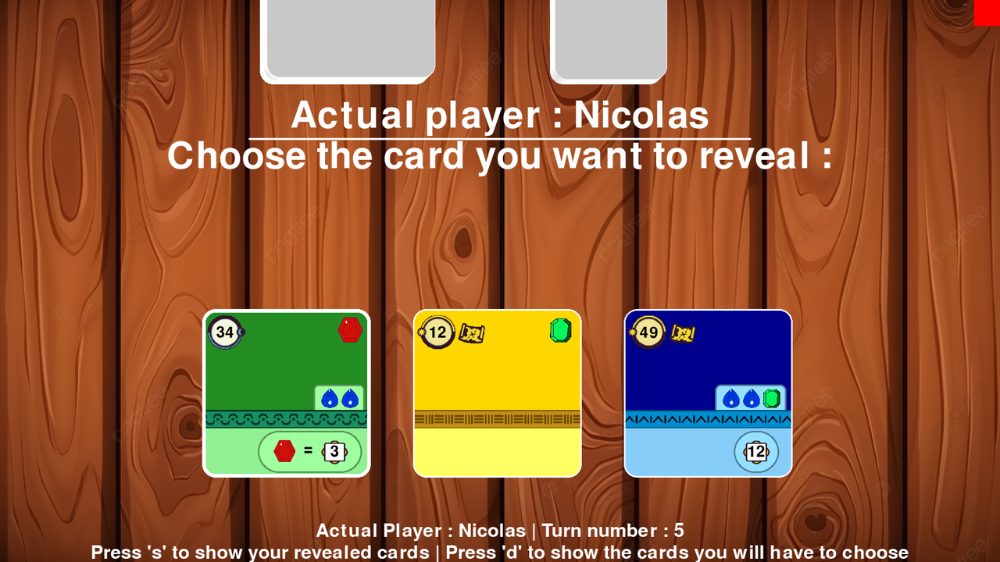
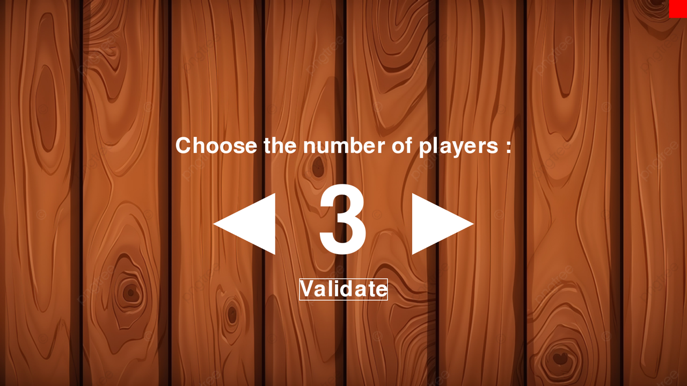
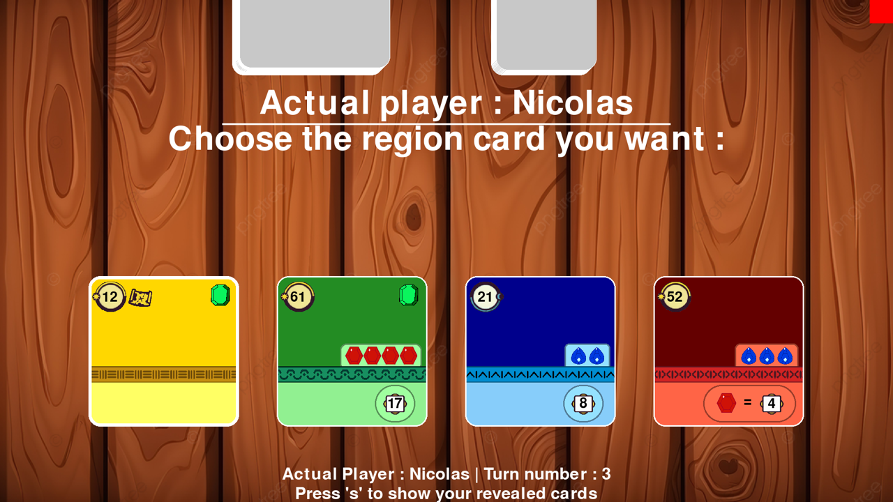
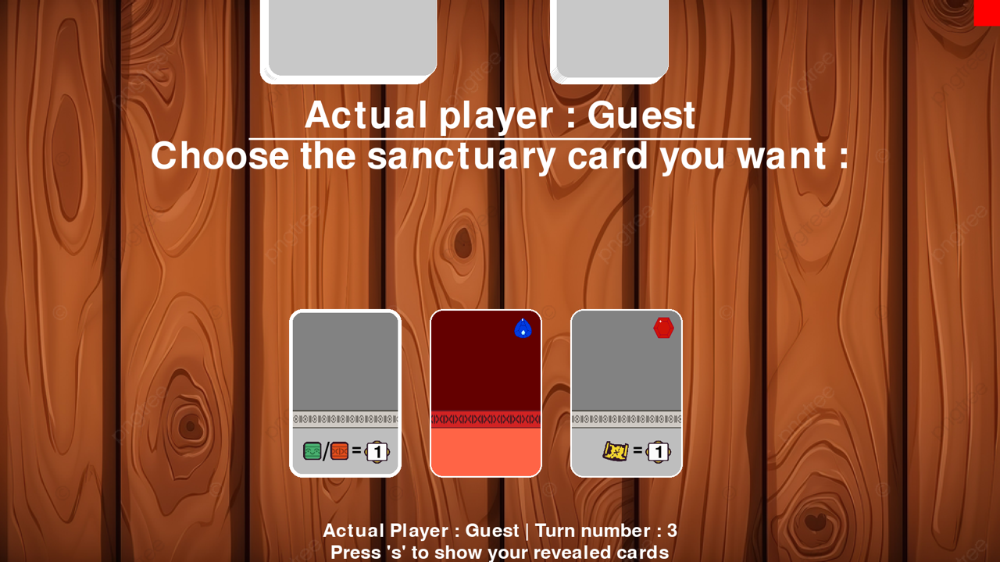
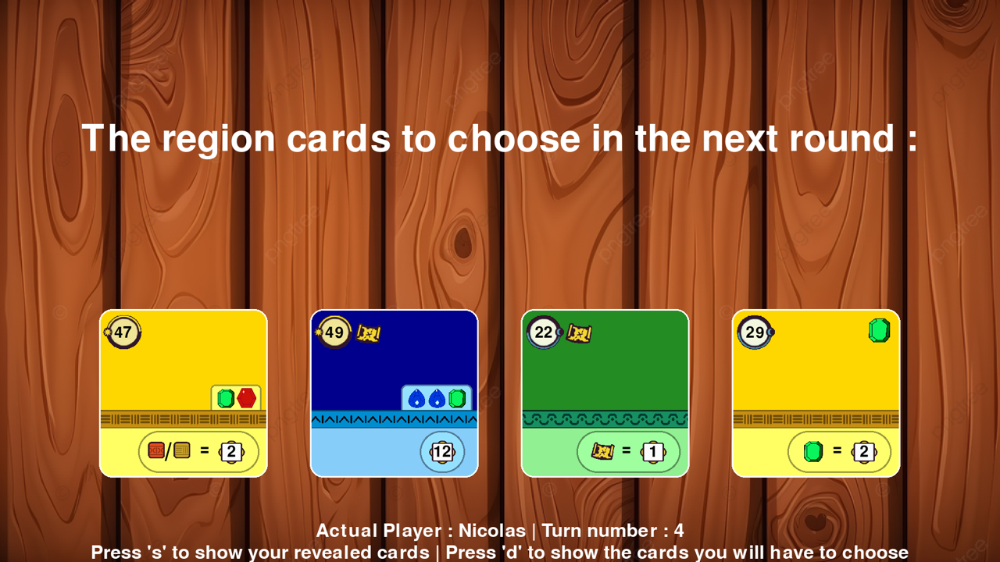
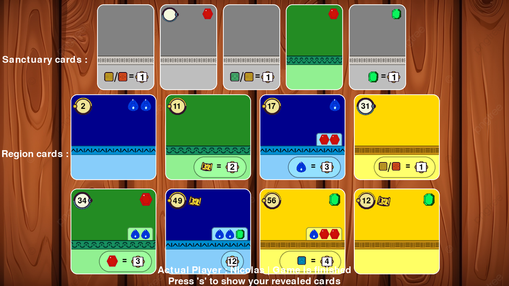
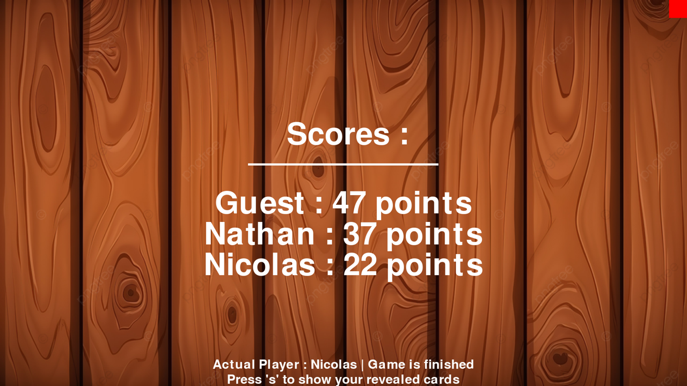

<div align="center">

# Faraway

**A digital adaptation of the *Faraway* card game, built in Python with Pygame.**




</div>

## About

This project is inspired by [**Faraway**](https://www.play-in.com/pdf/rules_games/faraway_-_regles_fr.pdf), the tabletop card game designed by Johannes Goupy and Corentin Lebrat and published by Catch Up Games. It recreates the game's rules for 2 to 6 players sharing one computer, with a full-screen graphical interface and a terminal mode.

It was built as a duo by **Nicolas Potel** and **Nathan Signouret** as a student project, from the UML design to the game logic, the unit tests and the Pygame interface.

> This is an unofficial project, not affiliated with or endorsed by the authors or publisher of the original game.

## Features

- All 68 region cards and 45 sanctuary cards, loaded from JSON files
- Full game loop over 8 turns, with final scoring
- Graphical interface with card animations, hover highlights and an animated score reveal
- Display that adapts to the screen resolution
- Terminal mode for playing without the graphical interface
- Unit tests, including simulated multi-turn game scenarios

## How the game works

A game lasts 8 turns, and each turn has three phases:

1. **Reveal:** each player plays one of the 3 region cards in their hand.
2. **Sanctuary:** a player whose new card has a higher number than their previous one draws sanctuary cards and keeps one. They choose from one card, plus one for each map on their cards.
3. **Region:** players take turns picking a new region card from the shared row, starting with the player who revealed the lowest number.

The twist comes at the end: region cards are scored **in reverse order**, from the last one played to the first. Each card can only use the resources revealed after it, so what you play early depends on what you plan to play later.

## Screenshots

<table>
  <tr>
    <td width="50%"><br><sub>Choosing the number of players</sub></td>
    <td width="50%"><br><sub>Picking a region card from the shared row</sub></td>
  </tr>
  <tr>
    <td width="50%"><br><sub>Keeping one sanctuary card</sub></td>
    <td width="50%"><br><sub>Previewing the next region cards</sub></td>
  </tr>
  <tr>
    <td width="50%"><br><sub>A player's tableau at the end of the game</sub></td>
    <td width="50%"><br><sub>Final scores</sub></td>
  </tr>
</table>

## Getting started

Tested with Python 3.13 and Pygame 2.6.1. Run all commands from the root of the repository.

```bash
git clone git@github.com:nicolasp025/faraway.git
cd faraway

python3 -m venv .venv
source .venv/bin/activate
pip install pygame pygame-textinput
```

| Command | Action |
| --- | --- |
| `make` | Start the game with the graphical interface (recommended) |
| `make game` | Start the game in the terminal |
| `make tests` | Run the unit tests |

## Controls

The graphical interface opens in full screen.

| Input | Action |
| --- | --- |
| Left click | Select a card or button |
| Hold `S` | Show your revealed cards |
| Hold `D` | Preview the region cards available next round (during the reveal phase) |
| Red square, top-right corner | Quit the game |

## Project structure

```text
├── data/            Card definitions (JSON) and images
├── src/
│   ├── card/        Cards and quests
│   ├── display/     Pygame rendering of the cards and menus
│   ├── enum/        Colors, stones, game states and condition modes
│   ├── game/        Shared board logic, terminal and graphical versions
│   ├── main/        Entry point
│   └── player/      Player state
├── test/            Unit tests
└── Makefile
```

`Board` holds the logic shared by both modes, such as card setup and scoring. `BoardClassical` and `BoardDisplay` build on it for the terminal and the Pygame interface.

## Possible improvements

- Load images once at startup instead of on every frame
- Add a more detailed scoring animation, card by card
- Refactor the display code

## Authors

- **Nicolas Potel**
- **Nathan Signouret**
